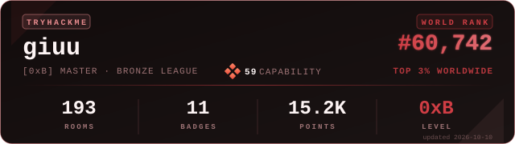

# TryHackMe Badge

A Repository that generates a beautiful, self-updating SVG badge with your live TryHackMe stats — rank, rooms, badges, level, league — straight from the official public profile API.

<p align="center">
  
</p>

> Custom fork of [`KeizerSec/Tryhackme-Badge`](https://github.com/KeizerSec/Tryhackme-Badge). **Pure Python. No Node. No Puppeteer. No Chrome.**

> **⚠️ Heads-up (June 2026).** TryHackMe moved its API behind Vercel's anti-bot challenge, which blocks every datacenter IP — so **GitHub-hosted runners can no longer fetch your stats**. The badge now refreshes from **any machine on a home/residential connection** via a small daily cron (see [Quick start](#quick-start)). Same badge, same themes — only *where it runs* changed.

---

## Features

- **Live data** — pulls from the official `tryhackme.com/api/v2/public-profile` endpoint, no auth required.
- **7 themes** — `midnight`, `matrix`, `synthwave`, `inferno`, `frost`, `cherry_dark`, `crimson`.
- **Rotating themes** — defaults to `rotate`: deterministic per UTC day, so visitors see the same theme worldwide on a given day, but it changes overnight.
- **Pure SVG** — no external fonts, no remote images, renders instantly through GitHub's image proxy.
- **Lightweight** — pure-Python SVG renderer plus one small helper (`curl_cffi`) for the fetch. No messy JS dependencies.

---

## Quick start

Run it from any machine on a **residential connection** (your laptop, a home server, a Raspberry Pi…). The provided `refresh.sh` script acts as a standalone worker: it clones your public profile repository into a hidden folder, updates the badge, pushes to GitHub, and cleans up.

### 1 — Install once

Python 3 and Git must already be installed.

```bash
# clone this repository wherever you like on your machine
git clone https://github.com/giuseppe-maglione/tryhackme-badge.git ~/tryhackme-badge
cd ~/tryhackme-badge
```

### 2 — Configure the script

Copy the `refresh.example.sh` script and edit the `# --- CUSTOM CONFIG ---` section at the top of it:

```bash
cp scripts/refresh.example.sh scripts/refresh.sh
nano refresh.sh
```

Make sure to set your TryHackMe username, your GitHub profile repo (e.g. `username/username`), and your preferred theme (e.g. `cherry_dark` or `rotate`).

### 3 — The refresh command (Test it)

Run the script manually to generate your first badge and push it to your profile repository:

```bash
chmod +x scripts/refresh.sh
./scripts/refresh.sh
```

Then reference the generated image in the `README.md` of your public profile repository:

```markdown

```

### 4 — Automate it (Weekly or Daily)

**Linux** — `crontab -e`, then add (e.g. every Sunday at 12:00):

```cron
0 12 * * 0 /home/<your-user>/thm-badge-scripts/refresh.sh >> /home/<your-user>/.github_profile/cron.log 2>&1
```
*(Alternatively, use `systemd` timers for a more robust setup on distros like Arch Linux).*

**macOS** — use `crontab -e` (if your scripts are outside `~/Documents`/`~/Desktop`), or use a LaunchAgent plist to run `refresh.sh` periodically.

**Windows** — use Task Scheduler to trigger a `.bat` wrapper that calls `bash.exe /path/to/refresh.sh` or run it via WSL.

> The badge only updates when your machine is on. If it's asleep at the scheduled time, modern cron alternatives (like `anacron` or `systemd` timers with `Persistent=true`) will run it the next time the machine is up.

---

## Python Script Environment Variables

If you want to run the python generator manually (`python3 src/generate.py`) without the bash script, you can pass these environment variables in UPPERCASE:

| Name | Required | Default | Description |
|---|:---:|---|---|
| `THM_USERNAME` | yes | — | Your TryHackMe username. |
| `OUTPUT_PATH` | no | `assets/thm_badge.svg` | Where the SVG is written. |
| `THEME` | no | `rotate` | `rotate` (deterministic per UTC day), `random` (per-run), or one of: `midnight`, `matrix`, `synthwave`, `inferno`, `frost`, `cherry_dark`, `crimson`. |
| `ACCENT_COLOR` | no | — | Hex color (e.g. `#00FF9D`) that overrides the theme accent and border. |

## Outputs

When executed, the Python script also appends the following to `$GITHUB_OUTPUT` (if set, useful for CI environments):

| Name | Description |
|---|---|
| `theme_used` | Name of the theme that was actually rendered. |
| `rank` | Current world rank value reported by the API. |

---

## Local preview

You can render any theme locally without cloning your profile repo:

```bash
python3 -m venv venv
source venv/bin/activate
pip install -r src/requirements.txt
THM_USERNAME=<thm_username> THEME=<theme> OUTPUT_PATH=/tmp/badge.svg python3 src/generate.py
```